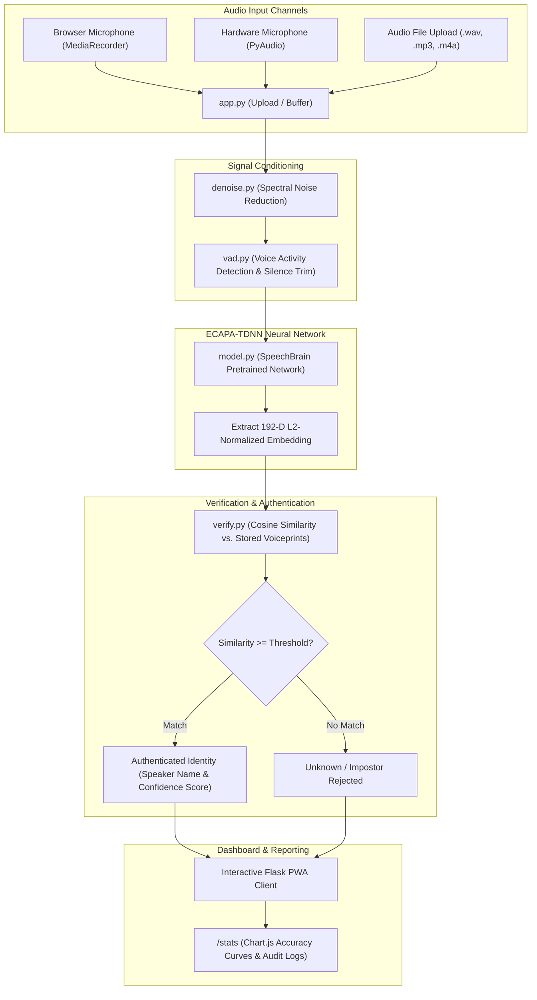

<div align="center">

# Voiceprint Identity System

<p>AI-powered voice biometric authentication and 1-to-N speaker identification platform powered by ECAPA-TDNN deep neural embeddings</p>


</div>

---


Traditional authentication factors such as passwords and PINs are increasingly vulnerable to phishing, brute-force attacks, and credential theft, while physical tokens introduce user friction. This platform solves the challenge of frictionless identity verification by analyzing the unique physical geometry of human vocal tracts through deep acoustic speaker recognition models. Built with SpeechBrain's state-of-the-art ECAPA-TDNN architecture, the application extracts 192-dimensional acoustic voice embeddings from speech signals, applies spectral denoising and voice activity detection, and performs real-time 1-to-N speaker identification and zero-trust authentication through an installable Progressive Web App.

---


- **ECAPA-TDNN Neural Embeddings**: Computes 192-dimensional acoustic speaker embeddings via SpeechBrain's VoxCeleb-pretrained deep neural network.
- **Real-Time 1-to-N Identification**: Evaluates speech against all registered voiceprints using cosine similarity comparison and calibrated confidence thresholds.
- **Signal Denoising & Voice Activity Detection**: Preprocessing pipeline integrating Voice Activity Detection (`vad.py`) and spectral noise reduction (`denoise.py` via `noisereduce`) to strip silence and ambient room noise.
- **Multi-Tenant User Isolation**: Strict per-account data segregation ensuring registered voice profiles, audio samples, and verification logs remain fully isolated.
- **Installable Progressive Web App (PWA)**: Modern glassmorphic interface with Service Worker caching, audio visualizer waveform canvas, and mobile-friendly `MediaRecorder` support.
- **Biometric Analytics Dashboard**: Dedicated statistics console (`/stats`) tracking total enrolled speakers, verification attempts, daily accuracy curves, and confusion metrics powered by Chart.js.

---


| Layer | Technology |
|---|---|
| **Deep Learning & Acoustic Modeling** | PyTorch, SpeechBrain (`spkrec-ecapa-voxceleb` ECAPA-TDNN) |
| **Audio Signal Processing** | SciPy, NumPy, SoundFile, PyAV, NoiseReduce |
| **Web Backend Framework** | Python 3.10+, Flask, Gunicorn |
| **Speech Synthesis & VAD** | PyTTSx3 (Offline Text-to-Speech), Web Audio VAD |
| **Frontend Client & PWA** | HTML5, CSS3 (Glassmorphism, Neon Pulse Visualizers), JavaScript (ES6+), Chart.js 4.4, Service Workers |
| **Data Persistence & Security** | Werkzeug Security (Password Hashing), SQLite / Isolated Embedding Stores |

---




---


### Prerequisites
- Python 3.10 or higher
- Git
- Microphone access (for live recording)
- FFmpeg installed on system path (recommended for multi-format audio decoding)

### 1. Clone the Repository
```bash
git clone https://github.com/tejas-coder28/Speech-Detection.git
cd Speech-Detection
```

### 2. Environment Setup & Dependencies
```bash
# Create and activate virtual environment
python -m venv venv

# Windows (Command Prompt / PowerShell)
.\venv\Scripts\activate

# macOS / Linux
source venv/bin/activate

# Install required packages
pip install -r requirements.txt
```

### 3. Environment Variables
Copy the template configuration file:
```bash
cp .env.example .env
```
Default parameters in `.env`:
```env
FLASK_APP=app.py
FLASK_ENV=development
SECRET_KEY=your_secret_key_here
PORT=5000
REMOTE_DEPLOYMENT=0
TORCH_HOME=./pretrained_models
```

### 4. Run the Web Application
```bash
# Direct development execution
python app.py

# Or via Gunicorn (WSGI)
gunicorn app:app -b 127.0.0.1:5000
```
Open `http://127.0.0.1:5000` in your web browser to launch the voiceprint identity console.

---


```
Speech-Detection/
├── docs/
│   └── assets/                   # Architecture charts & UI screenshots
├── static/
│   ├── css/style.css             # Glassmorphism styling & visualizer themes
│   ├── icon-192.png              # PWA mobile app icon
│   ├── icon-512.png              # PWA high-res app icon
│   ├── manifest.json             # Web App Manifest for mobile installation
│   └── sw.js                     # Service Worker for offline PWA caching
├── templates/
│   ├── index.html                # Main voice biometric dashboard UI
│   ├── login.html                # Multi-tenant account authentication
│   ├── register.html             # User registration interface
│   └── stats.html                # Accuracy metrics & historical verification graphs
├── tests/
│   ├── test_deletion.py          # Profile lifecycle tests
│   └── test_model.py             # Model inference & embedding tests
├── app.py                        # Flask server, route controllers & API endpoints
├── audio.py                      # Hardware microphone capture & audio verification
├── database.py                   # Multi-tenant user data store & embedding persistence
├── denoise.py                    # Spectral gating & noise reduction utilities
├── model.py                      # SpeechBrain ECAPA-TDNN model loader
├── register.py                   # Multi-segment enrollment pipeline
├── verify.py                     # Cosine similarity identification & thresholding
├── vad.py                        # Voice Activity Detection module
├── tts.py                        # Text-to-speech audio feedback generator
├── requirements.txt              # Python runtime dependencies
├── .env.example                  # Environment configuration template
├── LICENSE                       # MIT License
└── README.md                     # Project documentation
```

---


### 1. Voice Biometric Verification Interface
*Real-time speaker identification console featuring live waveform visualizer and confidence gauge.*


> *TODO: Capture screenshot of the main verification console at `http://127.0.0.1:5000` and save to `/docs/assets/01_voiceprint_verification_ui.png`.*

### 2. Multi-Segment Voice Enrollment
*Speaker enrollment workflow capturing three high-fidelity audio samples to synthesize the 192-D voiceprint.*


> *TODO: Capture screenshot of the enrollment modal and save to `/docs/assets/02_voice_enrollment_screen.png`.*

### 3. Biometric Analytics & Audit Statistics
*Interactive analytics dashboard tracking identification accuracy curves and per-speaker test attempts.*


> *TODO: Capture screenshot of `http://127.0.0.1:5000/stats` and save to `/docs/assets/03_biometric_analytics_stats.png`.*

---


- **Liveness & Anti-Spoofing Detection**: Integrate a deepfake acoustic classifier to block synthetic voice spoofing and replay attacks.
- **HNSW Vector Indexing (Qdrant / Milvus)**: Migrate from in-memory cosine matching to approximate nearest-neighbor vector search for scaling to 100,000+ enrolled identities.
- **WebAssembly (WASM) Edge Preprocessing**: Compile VAD and feature extraction routines to WebAssembly for edge filtering directly in client browsers.

---


**Tejas Muralidhar**
- GitHub: [@tejas-coder28](https://github.com/tejas-coder28)
- LinkedIn: [Tejas Muralidhar](https://www.linkedin.com/in/tejasmuralidhar)
